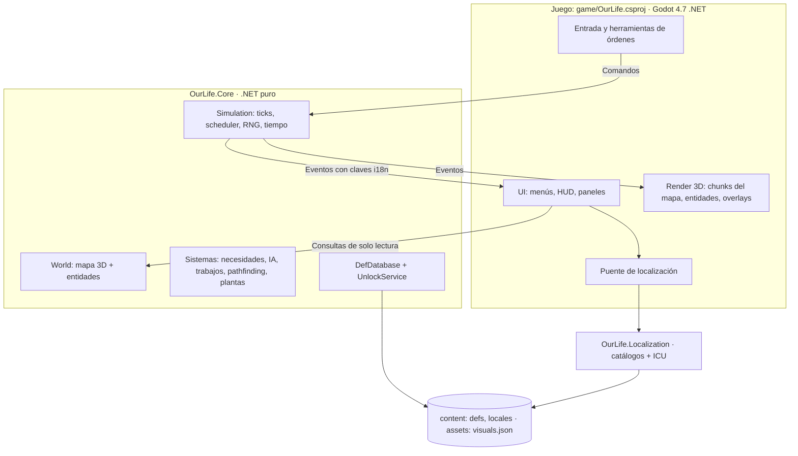

# Arquitectura: visión general

Resumen vivo de la arquitectura. El detalle completo está en la sección 3 del [plan maestro](../plan-maestro.md) y en los [ADR](adr/).

## Capas



## Reglas de dependencia

1. `OurLife.Core` no referencia Godot ni `OurLife.Localization`.
2. La presentación cambia el estado sólo con Comandos. La simulación informa con Eventos y consultas de solo lectura.
3. La simulación nunca genera texto final: emite `LocalizedText(clave, args)`.
4. Los números de balance viven en defs JSON.
5. Nada específico de una época va en código.

Las reglas 1 y la de determinismo se verifican con tests desde H1.1.

## Proyectos

| Proyecto | Ruta | Depende de | Notas |
|---|---|---|---|
| OurLife.Core | `src/OurLife.Core` | Nada | Simulación pura, `net8.0` |
| OurLife.Localization | `src/OurLife.Localization` | Nada | Catálogos e ICU propio, `net8.0` |
| OurLife (juego) | `game/OurLife.csproj` | Core, Localization | `Godot.NET.Sdk/4.7.2`, namespace `OurLife.Game` |
| OurLife.Core.Tests | `tests/OurLife.Core.Tests` | Core | Unidad, escenarios, determinismo, defs con contenido de prueba |
| OurLife.Localization.Tests | `tests/OurLife.Localization.Tests` | Localization | ICU, catálogos, `Localizer` |
| OurLife.Content.Tests | `tests/OurLife.Content.Tests` | Core, Localization | El contenido real de `game/content` y el código que lo usa. Compila `game/src/Content/LocaleCatalogs.cs`, que no usa Godot, para cargar los catálogos como el juego |

## Contenido

- Los defs viven en `game/content/defs/*.json`: cada archivo es un arreglo de defs y cada def declara su clase en `"type"`.
- `DefLoader` reporta todos los problemas juntos: JSON no estricto, tipos desconocidos, campos mal escritos, faltantes o en `null`, ids repetidos, referencias rotas y valores fuera de rango.
- `DefDatabase` ordena los defs de cada tipo por id, lo que les da un índice compacto. El índice cambia al agregar o quitar defs: las partidas guardan ids.
- La simulación se crea desde el contenido: `new Simulation(seed, defs)`. Sus valores de tiempo salen del def `TimeConfig`.
- `UnlockService` decide si un def está disponible según la época y los conocimientos de la colonia (ADR-008).
- Godot lee `res://content` con `GodotContentSource`; los tests leen la carpeta en disco con `FileSystemContentSource`. Las dos ignoran los archivos y carpetas ocultos o que empiezan con punto.

## Flujo de datos

- La entrada del jugador se traduce en Comandos encolados; la simulación los aplica al inicio del tick siguiente.
- Al final de cada tick, la simulación publica Eventos; el render y la UI se actualizan con ellos.
- Los paneles leen el estado con consultas de solo lectura.

## Tick de simulación

1. Aplicar los comandos encolados en orden de llegada.
2. Ejecutar los sistemas en orden fijo: necesidades, decisión, ejecución de trabajos, movimiento, plantas y limpieza.
3. Recalcular la conectividad si el mapa cambió.
4. Publicar los eventos y avanzar el contador.

## Núcleo: cómo escribir un sistema

```csharp
public sealed class HungerSystem : ISimSystem
{
    private readonly List<EntityId> _colonists = [];   // se reutiliza: sin asignaciones por tick

    public void Tick(Simulation simulation)
    {
        var rng = simulation.Random.Get("needs");      // un flujo aleatorio propio por sistema
        simulation.World.Query<Needs, Colonist>(_colonists);   // orden estable por id
        foreach (var colonist in _colonists)
        {
            var needs = simulation.World.Get<Needs>(colonist);   // clase simple, se modifica en el lugar
            needs.Hunger -= 3;
            if (needs.Hunger <= 0)
            {
                simulation.Events.Emit(new NotificationEvent(
                    simulation.CurrentTick,
                    LocalizedText.Of("event.colonist.starving").With("colonist", colonist),
                    NotificationSeverity.Danger));
            }
        }
    }
}

simulation.AddSystem(new HungerSystem(), interval: 10, offset: 3);   // corre cuando tick % 10 == 3
```

- Los componentes y los comandos son datos planos y serializables, sin referencias a otros objetos del juego.
- Las consultas copian los resultados, así que se puede crear o destruir entidades mientras se recorren.
- Los números del ejemplo son ilustrativos: los valores de balance van en defs JSON.
- La presentación cambia el estado sólo con `simulation.Commands.Enqueue(...)` y lee los eventos con `simulation.Events.DrainTo(...)`.

## Configuraciones de compilación

| Configuración de la solución | Proyectos .NET | Proyecto Godot | Tests |
|---|---|---|---|
| Debug | Debug | Debug | Se compilan |
| Release | Release | ExportRelease | Se compilan |
| ExportDebug | Debug | ExportDebug | No se compilan |
| ExportRelease | Release | ExportRelease | No se compilan |

## Estado de implementación

| Pieza | Hito | Estado |
|---|---|---|
| Solución, proyectos, tests de arquitectura y de determinismo, modo `--smoke` | H1.1 | Hecho |
| ECS ligero, ticks, RNG, calendario, comandos, eventos, hash de estado | H1.2 | Hecho |
| Defs, épocas, localización con ICU, puente Godot, ajustes | H1.3 | Hecho |
| Mapa 3D, generación, conectividad (`docs/gdd/mapa-y-generacion.md`) | H1.4 | Hecho |
| Render 3D low-poly, cámara, capturas (ADR-009) | H1.5 | Hecho |
| Pathfinding, IA, trabajos, necesidades | H1.6 | Pendiente |
| Entrada, HUD, menús | H1.7 | Pendiente |

## Decisiones

- [ADR-001: Godot 4.7 .NET con C#](adr/ADR-001-motor-godot-net.md)
- [ADR-002: Núcleo de simulación en .NET puro](adr/ADR-002-nucleo-dotnet-puro.md)
- [ADR-003: ECS ligero propio y mapa en arrays densos](adr/ADR-003-ecs-ligero-y-mapa-denso.md)
- [ADR-004: Simulación determinista](adr/ADR-004-simulacion-determinista.md)
- [ADR-005: Contenido en JSON validado](adr/ADR-005-contenido-en-json.md)
- [ADR-006: Localización con JSON e ICU](adr/ADR-006-localizacion-json-icu.md)
- [ADR-007: Render por capas TileMapLayer](adr/ADR-007-render-tilemaplayer.md), reemplazada por ADR-009
- [ADR-008: Épocas como datos](adr/ADR-008-epocas-como-datos.md)
- [ADR-009: Render 3D low-poly con el Nature Kit de Kenney](adr/ADR-009-render-3d-low-poly.md)
