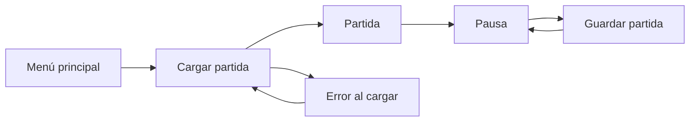

# Guardado y carga (H2.1)

Spec de H2.1 de IP2. El formato del archivo se decide en ADR-010.

## Qué se guarda

Todo el estado de la simulación, el mismo que recorre la huella (ADR-004):

- El tick, la semilla y el nombre de la aldea.
- Los flujos del RNG, cada uno con su estado.
- La época y los conocimientos.
- El mapa: forma, material y banderas de cada celda. Los materiales se guardan por id, no por índice.
- Las ranuras de entidades (generaciones y ranuras libres en su orden) y todos los componentes.
- Los comandos pendientes.

No se guardan los datos derivados de ADR-011 (conectividad, reservas, celdas con órdenes): se reconstruyen al cargar. Tampoco los eventos que la presentación todavía no leyó.

**Regla de continuidad:** guardar en el tick N, cargar y seguir hasta el tick M da la misma huella que correr hasta M sin cortar. La huella justo después de cargar es igual a la de antes de guardar.

## El nombre de la aldea

El nombre que el jugador escribe en Nueva partida pasa a la simulación (`Simulation.ColonyName`), entra en la huella y se guarda. Lo fija la llegada de la colonia. Es texto del jugador, no un texto del juego: no se traduce.

## Ranuras

- Cada partida guardada es un archivo en la carpeta de datos del usuario (`user://saves/`).
- Cada partida tiene un identificador que le da la presentación al empezarla y que se conserva al cargarla.
- **Guardado manual:** desde la pausa, "Guardar partida" abre la lista de ranuras. "Nueva ranura" crea una; elegir una existente pide confirmar antes de reemplazarla.
- **Autoguardado:** al empezar cada día del juego (a las 00:00), en una ranura de autoguardado propia de la partida, que se reemplaza cada día. No se autoguarda una colonia caída.
- Una ranura muestra el nombre de la aldea, la fecha y la hora del juego, la cantidad de colonos y cuándo se guardó, con la fecha y la hora del sistema. Las de autoguardado lo indican.
- Se escribe primero un archivo temporal y después se reemplaza el anterior, para que un corte no deje una ranura a medias.

## Pantallas

| Pantalla | Contenido |
|---|---|
| Menú principal | "Cargar partida" se habilita cuando hay al menos una ranura |
| Cargar partida | Lista de ranuras, de la más reciente a la más vieja. Cada una con Cargar y Borrar (Borrar pide confirmación). Volver |
| Pausa | Continuar, Guardar partida, Opciones y Menú principal |
| Guardar partida | "Nueva ranura" y la lista de ranuras manuales; elegir una pide confirmar el reemplazo. Al guardar, avisa "Partida guardada" y vuelve a la pausa. Volver |
| Error | Un título, el motivo localizado y un botón para volver. Se usa al fallar la carga de una partida y al fallar el arranque del juego |

## Errores

Una partida que no se puede cargar no cierra el juego. Los motivos que se distinguen:

| Motivo | Cuándo |
|---|---|
| Dañada | El archivo no se puede leer o le faltan datos |
| De una versión más nueva | La versión del formato es mayor que la del juego |
| De una versión vieja | La versión del formato es menor que la más vieja que el juego migra |
| Falta contenido | La partida usa un def que el contenido actual no tiene; el mensaje dice cuál |

Si el juego no puede arrancar porque el contenido no carga, muestra la pantalla de error con el detalle en lugar de cerrarse. Si lo que falla son los textos, el detalle se muestra tal cual, porque no hay con qué traducirlo.

## Textos nuevos

| Clave | es | en |
|---|---|---|
| `ui.pause.save` | Guardar partida | Save game |
| `ui.load.title` | Cargar partida | Load game |
| `ui.load.load` | Cargar | Load |
| `ui.load.delete` | Borrar | Delete |
| `ui.load.confirm_delete` | ¿Borrar la partida «{name}»? | Delete the saved game "{name}"? |
| `ui.load.empty` | No hay partidas guardadas | There are no saved games |
| `ui.save.title` | Guardar partida | Save game |
| `ui.save.new_slot` | Nueva ranura | New slot |
| `ui.save.overwrite` | Reemplazar | Replace |
| `ui.save.confirm_overwrite` | ¿Reemplazar la partida «{name}»? | Replace the saved game "{name}"? |
| `ui.save.done` | Partida guardada | Game saved |
| `ui.save.failed` | No se pudo guardar la partida | The game could not be saved |
| `ui.slot.summary` | {name}: {date}, {clock} · {count, plural, one {# colono} other {# colonos}} | {name}: {date}, {clock} · {count, plural, one {# settler} other {# settlers}} |
| `ui.slot.saved_at` | Guardada el {when} | Saved on {when} |
| `ui.slot.autosaved_at` | Autoguardado · Guardada el {when} | Autosave · Saved on {when} |
| `ui.common.yes` | Sí | Yes |
| `ui.common.no` | No | No |
| `ui.error.title` | Algo salió mal | Something went wrong |
| `ui.error.startup` | El juego no pudo arrancar: {detail} | The game could not start: {detail} |
| `ui.error.save_corrupt` | La partida está dañada y no se puede leer. | The saved game is damaged and cannot be read. |
| `ui.error.save_newer` | La partida es de una versión más nueva del juego. | The saved game is from a newer version of the game. |
| `ui.error.save_older` | La partida es de una versión vieja que ya no se puede cargar. | The saved game is from an old version that can no longer be loaded. |
| `ui.error.save_missing_content` | La partida usa contenido que no existe: {id}. | The saved game uses content that does not exist: {id}. |

El texto final de cada clave lo revisa el i18n-specialist; la tabla fija las claves y sus argumentos.

## Línea de comandos

- `--load <ranura>` abre la partida de esa ranura, para capturas y pruebas.
- El smoke guarda la partida en memoria a mitad de sus ticks, la carga en otra simulación, sigue las dos hasta el final y falla si las huellas difieren. También escribe y lee una ranura en una carpeta temporal.

## Criterios de aceptación

1. Test de continuidad en Core: en al menos tres semillas, guardar en un tick con colonos trabajando, órdenes, plantas recolectadas y comandos pendientes, cargar y seguir hasta otro tick da la misma huella que correr sin cortar.
2. Cargar con un contenido al que le falta un def referenciado, con una versión de formato distinta o con un archivo truncado da el error correspondiente, sin excepción sin capturar.
3. Desde la pausa se guarda en una ranura nueva y en una existente; desde el menú principal se carga y la partida sigue donde estaba: mismo valle, colonos, órdenes, fecha y nombre de la aldea.
4. El autoguardado aparece después de pasar la medianoche del juego.
5. "Cargar partida" está deshabilitado sin ranuras.
6. Todos los textos nuevos en es y en; capturas revisadas de Cargar partida, Guardar partida y Error.
7. Smoke con código 0, con la comprobación de guardado y carga.

## Fuera de alcance

- Migraciones entre versiones de formato, salvo las que se listan abajo.

## Versiones del formato

| Versión | Juego | Cambios |
|---|---|---|
| 1 | `v0.2.0` a `v0.2.5` | Primera versión |
| 2 | H3.2 de IP3 | Ritmo de la vida en la partida, edad y etapa (`life`) y apellido de cada colono. Una partida de la versión 1 se migra al cargarla: ver "Guardado y migración" en `vida-y-generaciones.md` |
| 3 | H3.3 de IP3 | Personalidad de cada colono (`personality`). Una partida de la versión 2 la recibe sorteada al cargarla |
| 4 | H3.4 de IP3 | Habilidades de cada colono (`skills`). Una partida de la versión 3 las recibe sorteadas como las de los fundadores |
| 5 | H3.5 de IP3 | Relaciones (`relations`), familia (`family`) e interacciones recientes (`recent_interactions`). Una partida de la versión 4 recibe opiniones sorteadas como las de los fundadores, sin pareja |
| 6 | H3.6 de IP3 | Pensamientos (`mood`), deseos (`desires`) y crisis (`crisis`). Una partida de la versión 5 empieza sin ellos: no hay nada que migrar |
| 7 | H3.7 de IP3 a `v0.3.0` | Embarazos (`pregnancy`), la opción de hijos (`set_children_allowed`) y la habilidad de crianza. Una partida de la versión 6 recibe la crianza sorteada como la de los fundadores y empieza sin embarazos |
| 8 | Desde L2 de IP3.5 | Libre albedrío prendido o apagado, centro de la aldea y metas de existencias (`set_free_will`, `set_stock_target`; ver `libre-albedrio.md`). Una partida de la versión 7 recibe el centro en la celda del colono más cerca del medio de todos, las metas por defecto y el interruptor que manda la sesión al cargarla |
| 9 | Desde L3 de IP3.5 | Trabajo por iniciativa (`Job.Initiative`, sólo escrito cuando es verdadero). Una partida de la versión 8 se lee igual: no hay nada que migrar |

- `SaveGame.OldestFormatVersion` es la versión más vieja que el juego todavía carga; una más vieja se rechaza como "de una versión vieja".
- `tests/OurLife.Content.Tests/Fixtures/v0.2.5.olsave` (versión 1, escrita con el código de `v0.2.5`), `h3.2.olsave` (versión 2, escrita con el de H3.2), `h3.3.olsave` (versión 3, con el de H3.3) `h3.4.olsave` (versión 4, con el de H3.4), `h3.5.olsave` (versión 5, con el de H3.5), `h3.6.olsave` (versión 6, con el de H3.6), `v0.3.0.olsave` (versión 7, con el de `v0.3.0`) y `l2.olsave` (versión 8, con el de L2 de IP3.5, con libre albedrío y una meta de madera de 70) son partidas reales. Los tests que las cargan cuidan las migraciones.
- Guardado en la nube y capturas de pantalla en las ranuras.
- Guardar con un nombre escrito por el jugador: las ranuras se nombran con la aldea.
