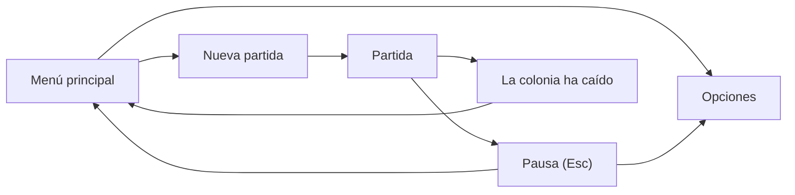

# Interacción y UI de la IP1 (H1.7)

Spec de las pantallas, los controles y la información que ve el jugador en la IP1. También incluye lo que quedó de H1.5: dibujar colonos y objetos, y seguir a las plantas que cambian. El contrato con la simulación está en `docs/gdd/colonos-e-ia.md` ("Contrato con la presentación").

## Pantallas



| Pantalla | Contenido |
|---|---|
| Menú principal | Título; botones Nueva partida, Cargar partida (deshabilitado hasta IP2), Opciones y Salir |
| Nueva partida | Nombre de la aldea, que trae un nombre por defecto; semilla, con un botón "Al azar"; Empezar y Volver |
| Partida | Vista 3D del valle con el HUD encima |
| Opciones | Idioma (Español, English), aplicado en vivo; pantalla (Ventana, Pantalla completa). En cada fila se resalta la opción activa. Las dos preferencias se guardan |
| Pausa | Se abre con Esc y pausa el tiempo. Botones Continuar, Opciones y Menú principal |
| La colonia ha caído | Aparece cuando muere el último colono. Botón Menú principal |

- La semilla es un número entero positivo. Si el campo queda vacío o no es un número, se usa una al azar. El azar de la semilla es de la presentación, no de la simulación.
- Generar el valle tarda menos de lo que se nota, así que no hace falta una pantalla de espera en la IP1.

## HUD de la partida

```
┌────────────────────────────────────────────────────────────┐
│ Día 3 de primavera de 1200, 14:20  [Pausa][1×][2×][4×]  Nivel 18 │
├──────────────────────────────────────────┬─────────────────┤
│                                          │ Inspector       │
│                MAPA 3D                   │                 │
├──────────────────────────────────────────┴─────────────────┤
│ Registro de eventos (últimos mensajes)                     │
├────────────────────────────────────────────────────────────┤
│ [Excavar M] [Escalera B] [Talar T] [Recolectar R] [Cancelar X] │
└────────────────────────────────────────────────────────────┘
```

- **Barra superior:** fecha y hora, botones de velocidad (pausa, 1×, 2× y 4×; el activo se resalta) y nivel Z actual.
- **Barra de órdenes:** un botón por orden. El activo se resalta y una línea explica cómo usarlo.
- **Inspector:** a la derecha, sólo cuando hay algo seleccionado.
- **Registro:** abajo, los últimos 6 mensajes, el más nuevo abajo, con la hora de cada uno. Guarda `LocalizedText`, así que al cambiar de idioma también cambia el historial.

## Controles

| Acción | Teclado | Ratón |
|---|---|---|
| Mover la cámara | WASD o flechas | |
| Zoom | | Rueda |
| Rotar 90° | Q / E | |
| Subir o bajar de nivel | RePág / AvPág | |
| Pausa | Espacio | Botón de pausa |
| Velocidad 1×, 2×, 4× | 1, 2, 3 | Botones de velocidad |
| Elegir orden | M, B, T, R, X | Botones de órdenes |
| Marcar un área | | Arrastrar con el botón izquierdo |
| Seleccionar | | Clic izquierdo sin orden activa |
| Salir de la orden o de la selección | Esc | Clic derecho |
| Menú de pausa | Esc sin orden ni selección | |

Las teclas de las órdenes son las mismas en los dos idiomas. Excavar usa la M ("minar", *mine*) porque la E ya rota la cámara.

## Selección de celdas

- El rayo de la cámara recorre la grilla celda por celda e ignora las que están por encima del nivel de la vista. La primera celda que no es aire es la apuntada: un muro (por arriba o por el costado), o una celda de suelo, rampa o escalera.
- Una celda apuntada se resalta con un marco.
- **Marcar un área:** al soltar el botón, la caja entre la celda del primer clic y la del último se envía como `DesignateCommand` con la orden activa. Mientras se arrastra se dibuja la caja. La caja queda en el nivel de la primera celda, para que arrastrar sobre una ladera no marque todas las celdas enterradas entre las dos alturas. Para abarcar varios niveles, por ejemplo una escalera, se cambia el nivel de la vista (RePág, AvPág) mientras se arrastra. Si el botón se suelta fuera del mapa o sobre el HUD, se marca la caja que se veía, hasta la última celda apuntada. Sobre el HUD no se enmarca ninguna celda.
- **Seleccionar:** un clic elige al colono cuyo modelo está bajo el ratón, el más cercano a la cámara. Si no hay ninguno, elige al colono de la celda apuntada o de la de arriba (con varios, el de menor id), y si tampoco hay, la celda. Un clic donde no hay nada, como el cielo, quita la selección.

## Inspector

| Seleccionado | Muestra |
|---|---|
| Colono | Nombre, qué hace (`job.<trabajo>.report`, o "Sin tarea") y cada necesidad en porcentaje |
| Celda | Coordenadas y nivel; forma y material, por ejemplo "Suelo de granito" o "Granite floor"; órdenes que tiene; planta (con "sin frutos" si está recolectada) y objetos que hay en ella |

- El inspector se actualiza mientras corre el tiempo. Si el colono muere, la selección se borra.

## Dibujo del mundo

- **Colonos:** el modelo de su criatura. Avanzan entre dos celdas según el progreso de su `Movement`, sin saltos. Se ocultan como las plantas, si están por encima del nivel de la vista o demasiado abajo.
- **Objetos:** una pila por celda, con el modelo de su objeto. Los cambios se siguen con los eventos de entidades.
- **Plantas:** aparecen, cambian y desaparecen con los eventos de entidades. Un arbusto recolectado usa el visual `<visual>.harvested` si el catálogo lo tiene.
- **Órdenes:** las celdas con orden de excavar o de escalera, y las plantas con orden de talar o recolectar, llevan una marca de color por tipo. Se redibujan con `DesignationsChangedEvent` y con los eventos de las plantas.
- **Escalera en ambos sentidos:** escalones con el hueco de la bajada.
- **Fuente:** se revisa Tiny5 sobre el 3D en las capturas. Si no se lee bien, se elige otra con el criterio de `docs/art.md`.

## Tiempo

- El juego avanza los ticks que pide `TickPacer` según la velocidad. Con la pausa, el menú de pausa o la pantalla de fin, no avanza.
- Después de cada cuadro con ticks, la presentación lee los eventos y actualiza el dibujo, el registro y el inspector.

## Textos nuevos

Todos van en `ui.json` de `es` y `en`, con estas claves (propuesta de texto en español):

| Clave | Español |
|---|---|
| `ui.mainmenu.load_later` | Disponible más adelante |
| `ui.newgame.title` | Nueva partida |
| `ui.newgame.colony_name` | Nombre de la aldea |
| `ui.newgame.default_name` | Valdeolmos |
| `ui.newgame.seed` | Semilla |
| `ui.newgame.random_seed` | Al azar |
| `ui.newgame.start` | Empezar |
| `ui.common.back` | Volver |
| `ui.common.main_menu` | Menú principal |
| `ui.options.title` | Opciones |
| `ui.options.display` | Pantalla |
| `ui.options.windowed` | Ventana |
| `ui.options.fullscreen` | Pantalla completa |
| `ui.pause.title` | Pausa |
| `ui.pause.resume` | Continuar |
| `ui.gameover.title` | La colonia ha caído |
| `ui.hud.date` | {date}, {clock} |
| `ui.hud.level` | Nivel {level} |
| `ui.hud.pause` | Pausa |
| `ui.hud.speed` | {speed}× |
| `ui.orders.mine`, `stairs`, `chop`, `harvest`, `cancel` | Excavar (M), Escalera (B), Talar (T), Recolectar (R), Cancelar (X) |
| `ui.orders.name.mine`, `stairs`, `chop`, `harvest`, `cancel` | Excavar, Escalera, Talar, Recolectar, Cancelar (para la ayuda) |
| `ui.orders.hint` | {order}: arrastra sobre el mapa. Clic derecho para terminar |
| `ui.inspector.idle` | Sin tarea |
| `ui.inspector.need` | {need}: {percent} % |
| `ui.inspector.cell` | Celda ({x}, {y}), nivel {z} |
| `ui.inspector.shape_material` | {shape} de {material} |
| `ui.inspector.shape.<forma>` | aire, suelo, muro, rampa, escalera hacia arriba, escalera hacia abajo, escalera (en minúscula: la interfaz pone la mayúscula al empezar la línea) |
| `ui.inspector.order.<orden>` | Marcado para excavar, … |
| `ui.inspector.plant_harvested` | {plant}, sin frutos |
| `ui.inspector.items` | {count} {item} |
| `ui.log.entry` | {clock} {text} |

## Línea de comandos

- Sin argumentos, el juego abre el menú principal.
- `--play` empieza una partida directamente con `--seed` (o la semilla 1), para capturas y pruebas.
- `--probe` sigue mostrando la pantalla de prueba de idioma.
- El smoke arma la pantalla de partida sin ventana y falla si falta algún texto.

## Criterios de aceptación

1. Con un perfil limpio, el juego abre el menú principal en español y todo texto visible está en español.
2. Cambiar el idioma en Opciones cambia todos los textos en vivo, incluido el historial del registro, y la preferencia persiste. La pantalla completa también persiste.
3. Nueva partida genera el valle con la semilla elegida. Se ven los 5 colonos y el tiempo corre, con pausa y las tres velocidades.
4. Un área marcada con una orden muestra sus marcas y los colonos la cumplen; Cancelar las quita.
5. El inspector muestra al colono (nombre, tarea y necesidades) y a la celda (forma, material, órdenes, planta y objetos).
6. El nivel cambia con RePág y AvPág y el HUD lo muestra.
7. Una muerte aparece en el registro; cuando muere el último colono aparece "La colonia ha caído".
8. Capturas en es y en revisadas del menú principal, de la partida con el inspector y el registro, y de las opciones.
9. Smoke con código 0, incluida la pantalla de partida.

## Fuera de alcance

- Guardar y cargar (IP2), prioridades de trabajo y lista de colonos (IP2).
- Reasignación de teclas y escala de la UI (IP8).
- Tutorial y ayudas (IP8).
