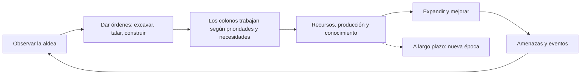

# Visión del juego

## Pitch

Guías de forma indirecta a un grupo de colonos humanos que fundan una aldea en un valle medieval. Talan, excavan sótanos y minas, construyen, producen y sobreviven al hambre, los inviernos, las bestias y los bandidos. Con el tiempo, la aldea podrá convertirse en una villa de la Edad Moderna y en una ciudad industrial. Las historias surgen de la simulación.

## Pilares

1. **Historias emergentes:** sistemas simples que interactúan, no guiones.
2. **Control indirecto:** el jugador da órdenes y prioridades; los colonos deciden.
3. **Profundidad vertical:** sótanos, minas y torres; el mapa es 3D.
4. **Todo por datos:** materiales, plantas, objetos, criaturas, recetas, conocimientos y épocas en JSON; base para mods.
5. **Bilingüe desde el día uno:** ningún texto visible fuera de los catálogos de idioma.
6. **Progreso en el tiempo:** la colonia avanza de época con su conocimiento; nada en el código asume una época concreta.

## El jugador

- **Rol:** el consejo invisible de la aldea. No mueve a los colonos uno por uno: marca órdenes como excavar, talar o construir, define zonas y ajusta prioridades.
- **Objetivo:** que la aldea sobreviva y prospere y, a largo plazo, que avance de época.
- **Derrota:** la colonia cae cuando muere el último colono.
- **Sin victoria final:** como en Dwarf Fortress, la partida sigue mientras el jugador quiera.

## Ambientación inicial

- Año 1200 por defecto, configurable.
- Un valle templado con colinas, bosques de robles y pinos, arbustos de bayas y afloramientos de roca.
- Humanos sin elementos fantásticos. Sumar fantasía queda como decisión abierta en el backlog.

## Bucle principal

## Referencias

| Juego | Qué tomamos |
|---|---|
| Dwarf Fortress | Simulación profunda, niveles Z, control indirecto, historias emergentes |
| RimWorld | Trabajos con prioridades, ánimo y pensamientos, narrador de eventos |
| Going Medieval | Colonia medieval con construcción y excavación en vertical |
| Dawn of Man | Avance de épocas impulsado por el conocimiento |

## Fuera de alcance por ahora

Fluidos dinámicos, multijugador, modo aventura, mundos persistentes entre partidas, y siglo XX y actualidad.
