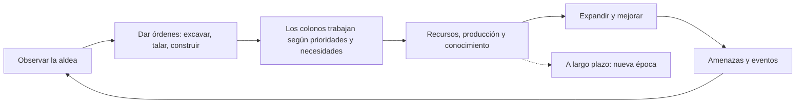
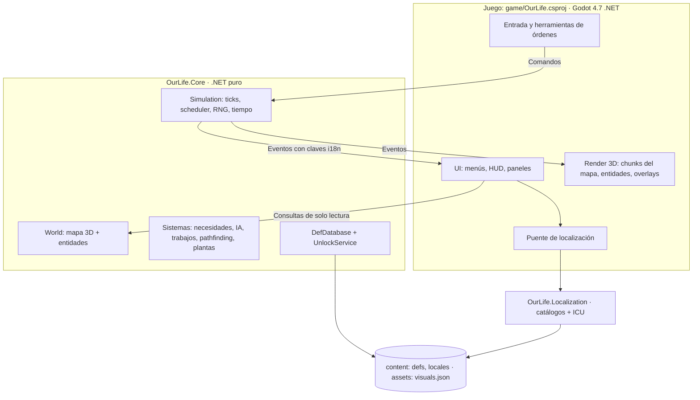
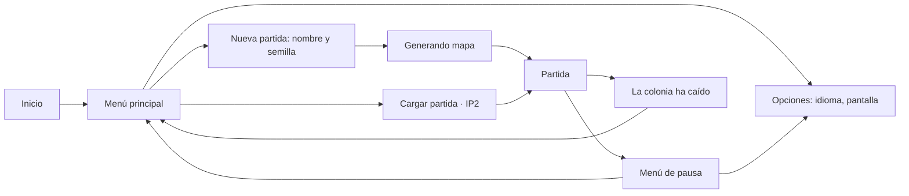
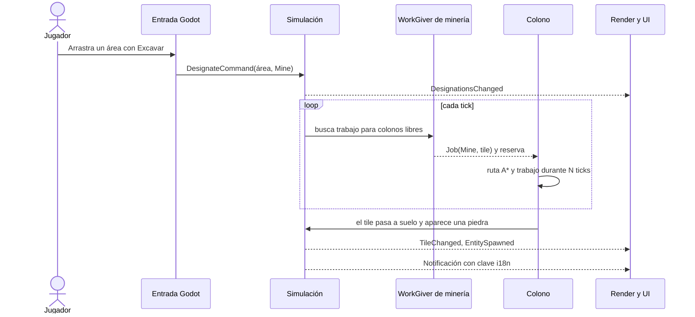
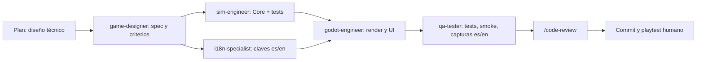
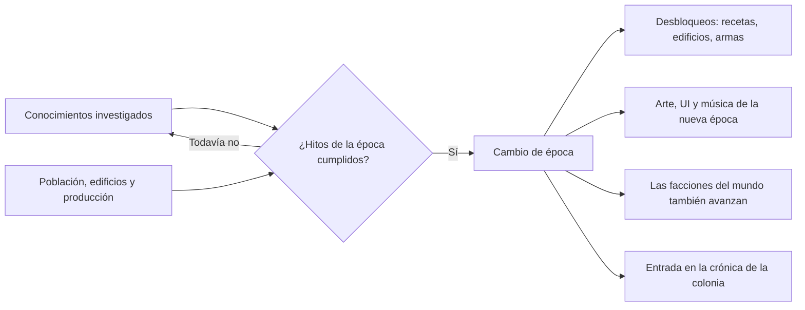

# Plan maestro: simulador de colonias estilo Dwarf Fortress, de la Edad Media en adelante

> Nombre provisional del proyecto: **OurLife** (por la carpeta `ourlife`).
>
> Copia del plan aprobado el 8-oct-2026. Ajustes aplicados en H1.1: Godot 4.7.2, `net8.0` en todos los proyectos y proyecto del juego `game/OurLife.csproj` (ver ADR-001).
>
> Ajuste del 9-oct-2026, antes de H1.4: el estilo visual pasa de pixel art 16×16 a 3D low-poly con el Nature Kit de Kenney (ADR-009, que reemplaza a ADR-007). La simulación no cambia. H1.5 y H1.7 suben de horas.

## 1. Contexto

Se quiere crear un juego de simulación de colonias al estilo de Dwarf Fortress, con textos en varios idiomas: español por defecto e inglés. El desarrollo es iterativo: cada IP (incremento) agrega funcionalidades y termina en una versión jugable, y la IP1 ya debe ser un juego funcional. La colonia empieza en la Edad Media y, como evolución futura, debe poder progresar en el tiempo por la Edad Moderna y la Edad Contemporánea. Esas épocas llegan en IPs finales, pero la arquitectura las contempla desde la IP1. Este plan define estructura, arquitectura, flujos de diseño, plan de desarrollo con estimaciones y los agentes de Claude Code a usar.

**Decisiones tomadas**

| Tema | Decisión |
|---|---|
| Motor | Godot 4.7.2 (edición .NET) con C# |
| Estilo visual | 3D low-poly sobre grilla cuadrada, con modelos CC0 del Nature Kit de Kenney desde la IP1 (ADR-009) |
| Mapa | Niveles Z: mapa 3D por capas, se ve un nivel a la vez y se excava hacia abajo |
| Temática | Humanos. Empieza en la Edad Media (aldea en un valle con colinas, bosques y roca) y en IPs futuras progresa a la Edad Moderna y la Contemporánea |
| Idiomas | Español por defecto (siempre, aunque el sistema operativo esté en otro idioma) e inglés |

**Estado del entorno (verificado)**
- `D:\Proyectos\Juegos\ourlife` está vacía y no es un repositorio git.
- Instalado: .NET SDK 10.0.300, runtimes .NET 8 y 10, git 2.43.
- No instalado: Godot, GitHub CLI.

**Supuestos (se pueden cambiar)**
- Un desarrollador trabajando con agentes de Claude Code. "Agentes" = subagentes de Claude Code.
- Código e identificadores en inglés. Documentación, specs y commits en español. Textos del juego en español neutro.
- La versión 1.0 es medieval (IP1 a IP8). Las épocas Moderna y Contemporánea llegan después (IP9 e IP10).

---

## 2. Visión del juego

**Pitch.** Guías de forma indirecta a un grupo de colonos humanos que fundan una aldea en un valle medieval. Talan, excavan sótanos y minas, construyen, producen y sobreviven al hambre, los inviernos, las bestias y los bandidos. Con el tiempo, la aldea podrá convertirse en una villa de la Edad Moderna y en una ciudad industrial. Las historias surgen de la simulación.

**Pilares**
1. **Historias emergentes:** sistemas simples que interactúan, no guiones.
2. **Control indirecto:** el jugador da órdenes y prioridades; los colonos deciden.
3. **Profundidad vertical:** sótanos, minas y torres; el mapa es 3D.
4. **Todo por datos:** materiales, plantas, objetos, criaturas, recetas, conocimientos y épocas en JSON; base para mods.
5. **Bilingüe desde el día uno:** ningún texto visible fuera de los catálogos de idioma.
6. **Progreso en el tiempo:** la colonia avanza de época con su conocimiento; desde la IP1 nada en el código asume una época concreta.

**Bucle principal**


**Fuera de alcance por ahora:** fluidos dinámicos, multijugador, modo aventura, mundos persistentes entre partidas, y siglo XX y actualidad (backlog posterior a IP10).

---

## 3. Arquitectura

### 3.1 Capas y reglas de dependencia



Reglas:
1. `OurLife.Core` no referencia Godot. Un test de arquitectura lo verifica.
2. La presentación sólo cambia el estado mediante **Comandos** encolados. La simulación sólo informa mediante **Eventos** y consultas de solo lectura.
3. La simulación nunca genera texto final: emite `LocalizedText(clave, args)`.
4. Todo número de balance vive en defs JSON, no en código.
5. Nada específico de una época va en código: épocas, conocimientos y desbloqueos son datos.

### 3.2 Núcleo de simulación (`OurLife.Core`)

**Tiempo y ticks**
- Paso fijo: 10 ticks/s a velocidad 1×. Las velocidades 2× y 4× ejecutan más ticks por frame. Pausa = 0 ticks.
- 1 tick = 1 minuto de juego. 1 día = 1 440 ticks, unos 2,4 minutos reales a 1×. Los valores viven en un def de configuración.
- Calendario con año absoluto, que empieza en 1200 por defecto y es configurable, pensado para recorrer siglos.
- En IP1 la simulación corre en el hilo principal con acumulador. El diseño por comandos y eventos permite moverla a un hilo propio más adelante (IP6/IP8).

**Determinismo**
- RNG propio (PCG32) con estado serializable y un flujo independiente por sistema (generación, IA, combate), para que agregar un sistema no cambie los resultados de otro.
- Prohibido en Core: `System.Random`, `DateTime.Now`, `Guid.NewGuid()`, decidir iterando `HashSet` o `Dictionary`, y `float` para cantidades acumulativas. Se usan enteros, por ejemplo necesidades de 0 a 10 000.
- Hash del estado con XxHash64: misma semilla + mismos comandos ⇒ mismo hash. Sirve para tests y para reproducir bugs con semilla + registro de comandos.

**Entidades: ECS ligero propio**
- `EntityId` (índice + generación) para referencias seguras.
- Componentes como clases POCO serializables: `Position`, `Mover`, `Colonist`, `Needs`, `JobRunner`, `Item`, `Plant`, `Inventory`…
- `ComponentStore<T>` tipo sparse set, iterado por `EntityId` ascendente para que el orden sea idéntico tras cargar una partida.
- Sistemas `ISystem` con intervalo (cada tick, cada 10, cada 250) y desfase por entidad para repartir la carga.
- `EntityGrid`: índice espacial de tile a entidades, para "qué hay aquí" y "comida más cercana".
- Motivo de no usar una librería ECS: la escala es de cientos a miles de entidades, y así hay control total del determinismo y del guardado, sin APIs de terceros que los agentes puedan confundir.

**Mapa 3D**
- Arrays densos por propiedad, indexados `x + y·W + z·W·H`: material (`ushort`, índice de def), forma (`byte`: vacío, suelo, muro, escalera arriba/abajo/ambas, rampa) y banderas (designación, oculto, exterior…).
- Diseño extensible: las capas nuevas por tile, como las redes de tuberías o cables de épocas futuras, se agregan como arrays nuevos sin tocar los existentes.
- Muros y suelos son tiles. Árboles, arbustos, objetos y criaturas son entidades.
- Chunks de 16×16 por nivel con marca de "sucio" para el render.
- Tamaño en IP1: 96×96×32, unos 295 000 tiles. Meta en IP8: 192×192×64.

**Movimiento y pathfinding**
- Se camina sobre suelo, escaleras y rampas. Se cambia de nivel por escaleras compatibles o rampas.
- Regiones de conectividad (flood fill 3D) recalculadas cuando cambia el mapa. Descartan en O(1) objetivos inalcanzables antes de lanzar A*.
- A* 3D (8 direcciones + vertical) con heurística octil, `PriorityQueue` de .NET y buffers reutilizados.
- En IP5: caché de rutas y HPA* para escalar.

**IA de colonos (modelo DF/RimWorld)**
- Las designaciones del jugador hacen que un `WorkGiver` por tipo de trabajo proponga `Job`s.
- Decisión priorizada: necesidad crítica → trabajo según prioridades del colono → necesidad leve → deambular.
- `JobDriver`: secuencia de pasos (ir a, trabajar N ticks, recoger, consumir, dormir) con manejo de fallos.
- Reservas para que dos colonos no tomen el mismo objetivo, y enfriamiento para objetivos inalcanzables.
- Se enriquece con personalidad, interacciones, pensamientos y ánimo en IP3 y con combate en IP5.

**Contenido por datos (Defs)**
- JSON estricto en `game/content/defs/`: `EraDef`, `MaterialDef`, `PlantDef`, `ItemDef`, `CreatureDef`, `NeedDef`, `WorkTypeDef`, `JobDef`, `NameListDef`. Más adelante `BuildingDef`, `RecipeDef`, `KnowledgeDef`, `ThoughtDef`…
- Todo def puede declarar `era` (época mínima) y `requires` (conocimientos necesarios). `UnlockService` responde qué está disponible; en IP1 sólo existe la época `medieval`.
- `DefDatabase` carga, valida referencias cruzadas y asigna índices compactos.
- Lectura mediante `IContentSource`: `FileAccess` de Godot en el juego y `System.IO` en tests, porque en el juego exportado `res://` no se puede leer con `System.IO`.
- Textos por convención de clave: `def.<tipo>.<id>.name` y `def.<tipo>.<id>.desc`.

```json
{ "type": "Plant", "id": "berry_bush", "visual": "plant.berry_bush", "era": "medieval",
  "harvest": { "item": "berries", "count": 5, "workTicks": 60 }, "regrowDays": 4 }
```

**Persistencia (IP2):** JSON + GZip con versión de formato y migraciones. Defs referenciadas por id de texto. Incluye el estado del RNG, el tick actual, la época y los conocimientos adquiridos.

### 3.3 Presentación (Godot)

- Proyecto en `game/` usando la solución raíz (`dotnet/project/solution_directory="../"`). La versión de `Godot.NET.Sdk` del `.csproj` (4.7.2) debe coincidir con la del editor instalado. Todos los proyectos usan `net8.0`, el framework de GodotSharp 4.7.2 (ADR-001).
- `GameRoot` (escena principal) monta los servicios: contenido, localización, ajustes en `user://settings.cfg` y navegación entre pantallas.
- **Mapa en 3D low-poly** (ADR-009)
  - Una celda mide una unidad de Godot de ancho y una de alto. La `x` del mapa va al eje X, la `y` al eje Z y el nivel `z` al eje Y.
  - Catálogo `assets/models/visuals.json`, que asocia cada id visual con un modelo `.glb`, su escala y si se tiñe. Cambiar el arte es cambiar modelos y JSON, sin tocar código.
  - Variantes por época: `house@modern` cae a `house` si la variante no existe. El `Theme` de UI y la música también se eligen por época.
  - Cada chunk de 16×16 por nivel tiene un `MultiMeshInstance3D` por tipo de pieza (bloque, suelo, rampa, escalera). Sólo se instancian las celdas expuestas.
  - Los modelos base son grises y se tiñen por instancia con el color del `MaterialDef`. Un mismo bloque sirve para tierra, granito, caliza o arenisca.
  - Corte por nivel: el nivel actual se ve cortado, con la roca sin excavar oscurecida por arriba. Se ven hasta 24 niveles inferiores, cada vez más oscuros, y los superiores se ocultan.
  - Overlay de designaciones y selección con mallas simples semitransparentes.
  - Sólo se reconstruyen los chunks sucios.
- **Vegetación y objetos:** un nodo por planta u objeto con su modelo. Se pasará a un `MultiMesh` por id visual y por chunk si el rendimiento lo pide, a más tardar en IP8 (ADR-009).
- **Colonos:** nodos `Node3D` en pool, con interpolación entre ticks para un movimiento suave.
- **Cámara:** `Camera3D` con inclinación fija, rotación en pasos de 90°, desplazamiento y zoom continuo con límites. Empieza en perspectiva; si cuesta leer el mapa, se pasa a ortográfica en H1.5.
- **Selección de celdas:** el rayo de la cámara se interseca con el plano del nivel actual, sin física.
- **Luz:** una luz direccional y luz ambiente, con el renderizador GL Compatibility.
- **Entrada:** acciones en `InputMap` (WASD/flechas para mover, rueda para zoom, Q/E para rotar, RePág/AvPág para nivel Z, Espacio para pausa, 1/2/3 para velocidad, atajos de órdenes, Esc). Modos: seleccionar, designar área arrastrando, cancelar.
- **UI:** 2D sobre el mapa, en un `CanvasLayer`, con Controls construidos en C# con un `UiBuilder` y un `Theme` global. Escenas `.tscn` mínimas, porque los agentes editan mal escenas complejas.
- **Modos de línea de comandos** (`OS.GetCmdlineUserArgs()`): `--smoke`, `--screenshot <png>`, `--locale <es|en>`, `--seed <n>`, `--ticks <n>`, `--level <z>` y `--probe`. Permiten que agentes y CI verifiquen el juego sin intervención humana.

### 3.4 Localización (i18n)

- Biblioteca `OurLife.Localization`, sin Godot y testeable con `dotnet test`.
- Catálogos JSON planos por idioma y dominio: `content/locales/es/ui.json`, `content.json`, `events.json` y sus equivalentes en `en/`.
- Formato ICU MessageFormat para plural, género y época, con la librería MessageFormat.NET (se valida en H1.3).
- Idioma inicial `es` si no hay preferencia guardada; no se usa el idioma del sistema. Idioma de respaldo: `es`. Una clave faltante se muestra como `⟦clave⟧` y se registra; los tests impiden que llegue a una versión.
- Puente Godot: cada catálogo se registra como `Translation` en `TranslationServer`, así los textos estáticos se traducen solos. Los dinámicos se regeneran al recibir `NotificationTranslationChanged`. El cambio de idioma es en vivo, sin reiniciar.
- El registro de eventos guarda `LocalizedText`, no cadenas: al cambiar de idioma, el historial también cambia.
- Argumentos con referencias: una entidad `{colonist}` aporta su nombre y `colonist_gender`. Un def `{item}` aporta su nombre con plural y género gramatical.
- Las claves no se atan a una época. Los términos que cambian con la época usan `select` sobre el argumento `era`.
- Convención de claves: `ui.<pantalla>.<elemento>`, `def.<tipo>.<id>.name|desc`, `job.<id>.report`, `event.<dominio>.<evento>`, `time.*`.
- Fuente pixel libre con cobertura de á é í ó ú ü ñ ¿ ¡, más una pantalla de prueba de caracteres.
- Los nombres de colonos son nombres propios y no se traducen; salen de listas por época en defs.

```jsonc
// es
"event.need.exhausted": "{colonist} está {colonist_gender, select, female {agotada} other {agotado}}.",
"ui.items.count": "{count, plural, one {# objeto} other {# objetos}}",
"ui.settlement.kind": "{era, select, medieval {Aldea} modern {Villa} other {Ciudad}}"
// en
"event.need.exhausted": "{colonist} is exhausted.",
"ui.items.count": "{count, plural, one {# item} other {# items}}",
"ui.settlement.kind": "{era, select, medieval {Village} modern {Town} other {City}}"
```

**Tests de i18n:** paridad de claves es/en, sintaxis ICU válida, mismos argumentos en ambos idiomas, toda clave usada en código o escenas existe, y ningún texto visible literal en la presentación.

### 3.5 Estrategia de pruebas

| Nivel | Herramienta | Qué cubre |
|---|---|---|
| Unidad | xUnit + Shouldly | Cada sistema del Core y la localización |
| Escenarios | xUnit con mapas escritos en ASCII | "5 colonos sobreviven 3 días", "el área designada queda excavada" |
| Determinismo | Hash de estado | Misma semilla y comandos ⇒ mismo resultado |
| Arquitectura | Reflexión | Core no referencia Godot |
| Épocas | xUnit con defs de prueba | Un def de otra época queda bloqueado en la Edad Media |
| i18n | xUnit | Paridad, ICU, argumentos, claves usadas |
| Humo | Godot `--headless --smoke` | Arranca, genera mapa, simula 5 000 ticks y sale con código 0 |
| Visual | Godot `--screenshot` | Capturas en es y en; las revisan el agente QA y el humano |
| Rendimiento | ms/tick en el smoke; BenchmarkDotNet desde IP5 | Presupuesto por IP |

Shouldly en lugar de FluentAssertions porque la versión 8 de esta última dejó de ser gratuita para uso comercial.

### 3.6 Decisiones de arquitectura (`docs/architecture/adr/`)

1. ADR-001: Godot 4 .NET + C#.
2. ADR-002: Núcleo de simulación en .NET puro, separado de Godot.
3. ADR-003: ECS ligero propio y mapa en arrays densos.
4. ADR-004: Simulación determinista de paso fijo con RNG por sistema.
5. ADR-005: Contenido en JSON validado (defs).
6. ADR-006: i18n con catálogos JSON + ICU; español por defecto; la simulación emite claves.
7. ADR-007: Render por capas `TileMapLayer` con `TileSet` generado desde `atlas.json`. Reemplazada por ADR-009 antes de implementarse.
8. ADR-008: Épocas como datos y progreso tecnológico continuo (el modelo se confirma en IP9).
9. ADR-009: Render 3D low-poly con el Nature Kit de Kenney, `MultiMesh` por chunk y catálogo de visuales.
10. ADR-010 (IP2): Guardado JSON comprimido y versionado.
11. ADR-011: Datos derivados de la colonia (conectividad incremental, reservas, celdas con órdenes) fuera de la huella.
12. ADR-012 (IP2.5): Terreno estilizado por shader, GL Compatibility y kits medievales (KayKit Dungeon y Mini Characters recoloreados).

### 3.7 Preparación para el progreso de épocas

**Modelo recomendado, a confirmar en IP9:** progreso tecnológico continuo, al estilo de Dawn of Man. La colonia avanza de época al reunir conocimientos clave y cumplir hitos de población, edificios y producción. El calendario sigue corriendo y las generaciones se renuevan con nacimientos y vejez. Queda como pregunta abierta para IP9 si conviene además un salto temporal opcional entre épocas.

**Ganchos que se construyen antes de IP9**

| IP | Gancho | Costo |
|---|---|---|
| IP1 | `EraDef` con sólo `medieval`, campos `era` y `requires` en los defs, `UnlockService`, calendario con año absoluto, variantes de modelo por época, regla 5 en `CLAUDE.md` | Unas 4 h, repartidas en H1.2, H1.3 y H1.5 |
| IP2 | Época y conocimientos dentro del formato de guardado | Incluido |
| IP3 | Generaciones: edad, nacimientos y muerte por vejez, adelantadas de IP9 | Incluido |
| IP4 | Árbol de conocimientos medieval que bloquea recetas y edificios | +10 h |
| IP5 | Armas a distancia genéricas por datos: arco y ballesta, luego mosquete | Incluido |
| IP7 | Facciones con nivel tecnológico propio, para que el mundo también avance | Incluido |

---

## 4. Estructura del repositorio

```
ourlife/
├── CLAUDE.md                     reglas para agentes: arquitectura, i18n, épocas, comandos, definición de hecho
├── README.md · CREDITS.md        cómo ejecutar · licencias de arte y fuentes
├── OurLife.sln · global.json · Directory.Build.props · .editorconfig · .gitignore · .gitattributes
├── .github/workflows/ci.yml      build + tests en cada push
├── .claude/
│   ├── agents/                   subagentes del proyecto (sección 6)
│   ├── skills/godot-run/SKILL.md compilar, smoke test y capturas
│   └── settings.json             permisos para dotnet y Godot
├── docs/
│   ├── plan-maestro.md           este plan
│   ├── gdd/                      visión, pilares, una página por sistema y eras.md
│   ├── architecture/             visión general + adr/
│   ├── i18n.md                   guía de localización y convención de claves
│   ├── art.md                    guía de arte: estilo 3D low-poly, paleta, modelos necesarios, variantes por época
│   └── ip/                       alcance, estado y criterios de cada IP + backlog.md
├── src/
│   ├── OurLife.Core/             simulación pura, sin Godot
│   │   ├── Ecs/ Sim/ Map/ WorldGen/ Defs/ Pathfinding/ Colony/ Entities/ Text/
│   │   └── Persistence/          (IP2)
│   └── OurLife.Localization/     catálogos + formateo ICU, sin Godot
├── game/                         proyecto Godot
│   ├── project.godot · OurLife.csproj
│   ├── content/defs/*.json       épocas, materiales, plantas, objetos, criaturas, trabajos, nombres
│   ├── content/locales/es|en/    ui.json, content.json, events.json
│   ├── assets/models/            modelos .glb por pack + visuals.json con variantes por época
│   ├── assets/fonts|icons|themes|audio/
│   ├── scenes/                   Main.tscn y prefabs mínimos
│   └── src/
│       ├── Bootstrap/            GameRoot, Services, Settings, CommandLine
│       ├── Session/              GameSession (tiempo real), GameScreen (une vista, entrada, HUD y menús)
│       ├── Rendering/            VisualCatalog, MapRenderer, EntityRenderer, OrderMarkers, WorldView
│       ├── Input/                CameraRig, CellPicker, GameInput, InputActions
│       ├── UI/                   UiTheme, UiBuilder, MainMenu, NewGameScreen, OptionsScreen, PauseMenu, GameOverScreen, Hud, InspectorPanel, EventLog
│       └── Localization/         GodotLocalizationBridge, TextResolver
├── tests/
│   ├── OurLife.Core.Tests/       unidad, escenarios ASCII, determinismo, arquitectura, épocas
│   └── OurLife.Localization.Tests/
└── tools/                        scripts de capturas y exportación
```

- Dependencias: `Game → Core` y `Game → Localization`. `Core` y `Localization` no dependen entre sí ni de Godot.
- Los tests leen `game/content/` directamente.
- El preset de exportación incluye `content/*.json` y `assets/models/visuals.json` en el filtro de archivos no-recurso. Verificado en H1.8: el ejecutable exportado pasa el smoke con la misma huella que el editor.

---

## 5. Flujos de diseño

### 5.1 Pantallas


### 5.2 Pantalla de partida (boceto, atajos provisionales)
```
┌────────────────────────────────────────────────────────────┐
│ Día 3 de primavera de 1200 · 14:20   ⏸ 1× 2× 4×   Nivel 18 │
├──────────────────────────────────────────┬─────────────────┤
│                                          │ Elvira          │
│   MAPA 3D                                │ Hambre   ▓▓▓░░  │
│   corte en el nivel actual + inferiores  │ Descanso ▓▓▓▓░  │
│                                          │ Talando un roble│
├──────────────────────────────────────────┴─────────────────┤
│ Rodrigo comió unas bayas. Sancho excavó granito.           │
├────────────────────────────────────────────────────────────┤
│ Excavar M  Escalera B  Talar T  Recolectar R  Cancelar X   │
└────────────────────────────────────────────────────────────┘
```

### 5.3 De una orden del jugador al resultado


### 5.4 Un tick de simulación
1. Aplicar los comandos encolados en orden de llegada.
2. Ejecutar sistemas en orden fijo: necesidades → decisión (asignar trabajos) → ejecución de trabajos → movimiento → plantas.
3. La conectividad se pone al día cuando se consulta después de un cambio del mapa (ADR-011).
4. Publicar los eventos acumulados y avanzar el contador de ticks.

En cada frame, Godot ejecuta los ticks que pida la velocidad, aplica los eventos al render e interpola el movimiento.

### 5.5 Agregar un texto
1. Elegir la clave según la convención.
2. Escribir el texto en `es` (fuente) y en `en` en el mismo commit.
3. Usarlo desde la presentación. En Core sólo se emite `LocalizedText`.
4. Correr los tests de i18n.
5. Revisar capturas en ambos idiomas buscando textos cortados.

### 5.6 Agregar contenido sin tocar código
1. game-designer define el def JSON con sus números, su época y sus conocimientos requeridos.
2. art-integrator agrega el modelo al catálogo de visuales y la licencia a `CREDITS.md`.
3. i18n-specialist agrega nombre y descripción en es y en.
4. El test de validación de defs comprueba referencias, visuales, claves y desbloqueos.
5. El contenido aparece en el juego cuando su época y sus conocimientos están disponibles.

### 5.7 Un hito con agentes


### 5.8 Progreso de épocas (futuro, IP9 en adelante)


---

## 6. Agentes de Claude Code

### 6.1 Integrados y skills

| Herramienta | Uso |
|---|---|
| Agente Plan | Diseño técnico detallado al comenzar cada hito |
| Agente Explore | Búsquedas amplias cuando el código crezca |
| `/code-review` | Revisión al cerrar cada hito |
| `/simplify` | Limpieza de calidad al cerrar cada IP |
| `/run` + skill de proyecto `godot-run` | Lanzar el juego, smoke test y capturas |
| `/fewer-permission-prompts` | Reducir confirmaciones de comandos dotnet y Godot |

### 6.2 Agentes del proyecto (`.claude/agents/*.md`)

| Agente | Responsabilidad | Herramientas | Modelo | Desde |
|---|---|---|---|---|
| game-designer | Specs con criterios de aceptación, balance, defs JSON, GDD, investigación histórica de cada época | Read, Write, Edit, Glob, Grep, WebSearch, WebFetch | inherit | IP1 |
| sim-engineer | Sistemas de `OurLife.Core` con tests; determinismo | Todas | inherit | IP1 |
| godot-engineer | Render, entrada, UI, modos smoke y captura | Todas | inherit | IP1 |
| i18n-specialist | Claves, textos es/en, ICU, tono y concordancia | Read, Write, Edit, Glob, Grep, shell para tests | sonnet | IP1 |
| art-integrator | Modelos 3D CC0 (Nature Kit y otros kits de Kenney), `visuals.json`, variantes por época, tintes, `CREDITS.md`, faltantes | Read, Write, Edit, Glob, Grep, shell | sonnet | IP1 |
| qa-tester | Escenarios, smoke, capturas es/en revisadas, reporte de bugs | Todas | sonnet | IP1 |
| perf-engineer | Perfilado, benchmarks, HPA*, hilos, mallas combinadas y niveles de detalle en el render, simulación por nivel de detalle | Todas | inherit | IP5 |

`inherit` usa el modelo de la sesión principal para el razonamiento pesado. `sonnet` abarata tareas repetitivas.

### 6.3 Ejemplo de definición

```markdown
---
name: sim-engineer
description: Implementa y prueba sistemas de simulación en src/OurLife.Core (C# puro, sin Godot). Usar para mapa, generación, pathfinding, IA, trabajos, necesidades, épocas y guardado.
tools: Read, Write, Edit, Glob, Grep, Bash, PowerShell
model: inherit
---
Eres el ingeniero de simulación de OurLife.
- Nunca referencies Godot desde OurLife.Core.
- Determinismo: usa el Rng del sistema correspondiente; nada de System.Random, DateTime, Guid
  ni decisiones que dependan del orden de HashSet o Dictionary.
- Enteros para cantidades; los números de balance van en defs JSON.
- Nada específico de una época en código: épocas, conocimientos y desbloqueos son datos.
- Texto para el jugador: emite LocalizedText(clave, args) y lista las claves nuevas para i18n-specialist.
- Todo sistema nuevo llega con tests de unidad y al menos un escenario con mapa ASCII.
- Termina con `dotnet build` y `dotnet test` en verde y reporta archivos tocados y resultados.
```

### 6.4 Orquestación
- La sesión principal coordina. Los agentes reciben specs con criterios de aceptación y devuelven archivos tocados, comandos ejecutados y resultados.
- Trabajo en paralelo sólo con el contrato fijado (comandos, eventos y consultas): sim-engineer y godot-engineer en worktrees aislados.
- El humano aprueba specs, instala herramientas, juega cada hito y decide arte y balance.
- `CLAUDE.md` resume reglas de arquitectura, i18n, determinismo, épocas, convenciones, comandos y la definición de hecho.

---

## 7. Plan de desarrollo

### 7.1 Resumen y estimaciones

Las horas son dedicación del desarrollador trabajando con agentes: decisiones, revisión, playtest, editor de Godot y supervisión. Margen recomendado: +20 %. La columna de fecha supone inicio el 12-oct-2026, 20 h por semana, la mitad del rango de horas de cada IP y sin margen.

**Fase 1: versión 1.0 medieval**

| IP | Nombre | Qué se puede jugar al terminar | Horas | Semanas a 10 / 20 / 40 h | Fin aprox. |
|---|---|---|---|---|---|
| IP1 | Primeros colonos | Valle 3D, 5 colonos, excavar, escaleras, talar, recolectar, hambre y sueño, es/en | 112–153 | 11–15 / 6–8 / 3–4 | nov 2026 |
| IP2 | Asentamiento | Almacenes, acarreo, construcción y muebles, guardar y cargar, prioridades, día y noche | 77–101 | 8–10 / 4–5 / 2–3 | dic 2026 |
| IP2.5 | Pulido visual | Terreno con textura y decoración, muebles medievales, colonos animados, vista previa de muebles y tamaño de la interfaz | 38–55 | 4–6 / 2–3 / 1 | nov 2026 |
| IP3 | Vida y generaciones | Edad y etapas de la vida, personalidad, interacciones, relaciones, habilidades, ánimo, deseos, parejas, nacimientos y muerte por vejez | 95–135 | 10–14 / 5–7 / 3–4 | feb 2027 |
| IP4 | Oficios | Talleres, recetas, producción, agricultura, metales, conocimientos, habitaciones y comedor | 105–130 | 11–13 / 6–7 / 3–4 | mar 2027 |
| IP5 | Peligros | Salud, combate, fauna y caza, bandidos, milicia, medicina | 90–120 | 9–12 / 5–6 / 2–3 | abr 2027 |
| IP6 | Estaciones | Estaciones, clima, temperatura, antorchas, agua, migrantes, comercio | 80–110 | 8–11 / 4–6 / 2–3 | jun 2027 |
| IP7 | Mundo y leyendas | Mapa del mundo, facciones, historia generada, elección de sitio, crónicas | 90–130 | 9–13 / 5–7 / 2–3 | jul 2027 |
| IP8 | Publicación 1.0 | Rendimiento, audio, tutorial, accesibilidad, mods, QA de idiomas, exportación | 80–120 | 8–12 / 4–6 / 2–3 | ago 2027 |
| **Total 1.0** | | | **767–1 054** | **77–106 / 39–53 / 20–27** | **ago 2027; oct 2027 con margen** |

**Fase 2: progreso de épocas (futuro, posterior a la 1.0)**

| IP | Nombre | Qué se puede jugar al terminar | Horas | Semanas a 10 / 20 / 40 h | Fin aprox. |
|---|---|---|---|---|---|
| IP9 | Edad Moderna | Cambio de época, linajes, imprenta, pólvora, la aldea se vuelve villa | 105–140 | 11–14 / 6–7 / 3–4 | oct 2027 |
| IP10 | Edad Contemporánea | Revolución Industrial: vapor, electricidad, fábricas, saneamiento | 140–190 | 14–19 / 7–10 / 4–5 | nov 2027 |
| **Total con épocas** | | | **1 012–1 384** | **102–139 / 51–70 / 26–35** | **nov 2027; feb 2028 con margen** |

IP1 sumó 12 a 18 h el 9-oct-2026 por el paso a 3D low-poly (ADR-009). IP2 sumó 7 a 11 h el 11-oct-2026: el ciclo de día y noche visual, adelantado de IP6, y el sueño nocturno de los colonos. IP6 conserva sus horas. IP2.5 se sumó el 14-oct-2026, a pedido del usuario, entre IP2 e IP3: corre las fechas siguientes unas dos semanas y adelanta la escala de UI de IP8. El 15-oct-2026, a pedido del usuario, la vida de los colonos pasa antes de los oficios: la nueva IP3 "Vida y generaciones" junta los rasgos, las relaciones y el ánimo de la antigua IP4, las habilidades de la antigua IP3 y las generaciones de IP9, y suma la personalidad que cambia con las vivencias, los deseos y el ritmo de la vida elegido al crear la partida. Oficios pasa a IP4, con las habitaciones y el comedor de la antigua IP4. El total crece de 40 a 65 h y las fechas siguientes se corren unas tres semanas. Las fechas siguen siendo aproximadas.

El arte de las épocas Moderna y Contemporánea probablemente requiera encargar o comprar modelos 3D. Ese costo no está incluido en las horas.

### 7.2 IP1: Primeros colonos (detallada)

**Objetivo.** Abrir el juego en español, generar un valle con niveles Z y mantener vivos a 5 colonos dándoles órdenes. Poder cambiar a inglés en vivo.

**Alcance**
- Menú principal: Nueva partida, Opciones, Salir. "Cargar" visible pero deshabilitado hasta IP2.
- Opciones: idioma (Español por defecto / English) aplicado en vivo y guardado; pantalla completa.
- Nueva partida: nombre de la colonia y semilla.
- Generación de un valle de 96×96×32: pasto y tierra en superficie, colinas con roca expuesta, 2 a 5 niveles de tierra y luego estratos de piedra (granito, caliza, arenisca), robles, pinos, arbustos de bayas y rampas en las pendientes.
- 5 colonos humanos con nombre y género, y 30 raciones de provisiones.
- Órdenes:
  - Excavar muros: dejan suelo y a veces una piedra.
  - Escalera hacia abajo: abre una escalera en el nivel actual y su salida en el inferior.
  - Talar árboles, que dejan troncos.
  - Recolectar bayas.
  - Cancelar designaciones.
- Trabajos automáticos con reservas.
- Necesidades: hambre (comen provisiones o bayas) y descanso (duermen en el suelo). Muerte por inanición y fin de partida si mueren todos.
- Vista 3D low-poly con el Nature Kit de Kenney. Cámara con desplazamiento, zoom, rotación en pasos de 90° y cambio de nivel. La vista corta el mapa en el nivel actual y muestra los niveles inferiores oscurecidos.
- HUD: fecha con año, hora, pausa, 1×, 2× y 4×, nivel Z y barra de órdenes.
- Inspector de colono (nombre, necesidades, trabajo actual) y de tile (material, forma).
- Registro de eventos localizado.
- Preparación de épocas: calendario desde el año 1200, defs con época y conocimientos requeridos, y variantes de modelo por época. Todo el contenido de IP1 es medieval.
- Exportación Windows jugable `v0.1.0`.

**Hitos**

| Hito | Contenido | Agentes | Horas | Entregable verificable |
|---|---|---|---|---|
| H1.1 Fundaciones | git, solución y proyectos, `Directory.Build.props`, `global.json`, proyecto Godot, CI, `CLAUDE.md`, agentes, skill `godot-run`, docs y ADRs, modo `--smoke` vacío | Sesión principal, godot-engineer | 8–12 | `dotnet test` en verde, Godot abre el proyecto, `--smoke` sale con 0 |
| H1.2 Núcleo | ECS ligero, bucle de ticks, scheduler, RNG, calendario con año absoluto, comandos, eventos, hash de estado | Plan, sim-engineer, qa-tester | 10–14 | Misma semilla ⇒ mismo hash tras 10 000 ticks |
| H1.3 Contenido e i18n | `DefDatabase` y validación, `EraDef`, campos `era` y `requires`, `UnlockService`, defs iniciales, `Localization` con ICU, puente Godot, ajustes, fuente pixel | game-designer, sim-engineer, i18n-specialist, godot-engineer | 14–18 | Tests de defs, épocas e i18n en verde; una etiqueta cambia en vivo entre "Nueva partida" y "New game" |
| H1.4 Mapa y generación | Mapa 3D, chunks, generación con ruido (FastNoiseLite C#), estratos, vegetación, rampas, conectividad | sim-engineer, game-designer | 10–14 | Misma semilla ⇒ mismo mapa; superficie conectada; generación < 2 s |
| H1.5 Render y cámara | Modelos CC0 del Nature Kit de Kenney y faltantes; `visuals.json` con variantes por época; campo `visual` en los defs; terreno por chunks con `MultiMesh` y tinte por material; corte por nivel Z; vegetación, objetos y colonos; cámara 3D; luz; modo `--screenshot` | art-integrator, godot-engineer | 24–32 | Captura del valle en 3D con colinas y árboles, y otra con el corte en un nivel subterráneo y los inferiores oscurecidos |
| H1.6 Colonos e IA | A* 3D, reservas, decisión priorizada, WorkGivers y JobDrivers (excavar, escalera, talar, recolectar, comer, dormir, deambular), necesidades, muerte | Plan, sim-engineer, qa-tester | 20–26 | Escenarios "5 colonos 3 días con bayas ⇒ todos vivos" y "área designada ⇒ excavada" |
| H1.7 Interacción y UI | Modos de entrada, selección de celdas con el rayo de la cámara, designación por arrastre, HUD, inspector, registro, menú principal, pausa, opciones | godot-engineer, i18n-specialist | 16–22 | Partida completa jugable con ratón y teclado en es y en |
| H1.8 Integración | Playtest, balance, bugs, ms/tick, README, plantillas de exportación, export Windows | qa-tester, game-designer, `/code-review`, humano | 10–14 | `v0.1.0` exportada y checklist de playtest completo |

**Ruta crítica:** H1.1 → H1.2 → (H1.3 ∥ H1.4) → (H1.5 ∥ H1.6) → H1.7 → H1.8.

**Definición de hecho de IP1**
- Con un perfil de usuario limpio, el juego arranca en español y todo texto visible está en español.
- Cambiar a inglés en Opciones cambia todos los textos sin reiniciar, incluido el historial de eventos. La preferencia persiste.
- Misma semilla ⇒ mismo mapa.
- Los colonos ejecutan las órdenes, comen, duermen y pueden morir de hambre.
- Un def de prueba de otra época queda bloqueado: nada medieval está fijado en código.
- `dotnet test`, smoke test y test de determinismo en verde. Capturas es/en revisadas.
- Presupuesto: menos de 2 ms por tick de media y 60 FPS en el mapa de IP1.

### 7.3 IP2 a IP8: versión 1.0 medieval

**IP2 · Asentamiento (77–101 h).** Agentes: sim-engineer, godot-engineer, i18n-specialist, qa-tester.
- Zonas de almacén con filtros por categoría; acarreo y apilado de objetos.
- Construcción por planos: muros, suelos, puertas, escaleras y rampas. Muebles: cama, mesa, silla, cofre. Entrega de materiales, trabajo de construcción y desmontaje.
- Canalizar para abrir huecos hacia el nivel inferior.
- Camas asignadas que mejoran el descanso.
- Guardar y cargar con ranuras y autoguardado diario, incluyendo época y conocimientos; test "guardar a mitad y seguir = partida continua".
- Panel de prioridades de trabajo (colono × tipo de trabajo) y lista de colonos.
- Alertas: colono ocioso, hambre crítica.
- Ciclo de día y noche visual, adelantado de IP6:
  - El sol cruza el cielo según la hora del juego, y la luz, el ambiente y el cielo cambian del amanecer al día, al atardecer y a la noche.
  - La noche nunca queda a oscuras del todo, y el ciclo se puede apagar en Opciones.
  - Es de presentación: no cambia la simulación ni las huellas.
  - Estimación: 4 a 6 h.
- Sueño nocturno:
  - Los colonos prefieren dormir de noche. El horario es un dato de los defs, no código.
  - Un colono agotado duerme igual a cualquier hora, y el balance del hambre y del invierno de IP1 se revisa con el nuevo horario.
  - Estimación: 3 a 5 h.
- **Jugable:** construir una casa con camas, ordenar el almacén, ver a la aldea dormir de noche y retomar la partida otro día.

**IP2.5 · Pulido visual (38–55 h).** Agentes: godot-engineer, art-integrator, i18n-specialist, qa-tester. Detalle en `docs/ip/IP2.5.md`.
- Prueba de estilo con capturas: textura del terreno y renderizador (GL Compatibility o Forward+), elegidos por el usuario.
- Terreno con pasto sólo arriba, textura y variación por material; decoración del suelo sólo visual.
- Modelos provisionales reemplazados, muebles medievales, variantes de aldeanos y sus animaciones.
- Vista previa del mueble girado al colocarlo, y planos de muebles con su modelo.
- Tamaño de la interfaz en Opciones, con modo automático según la resolución.
- **Jugable:** la misma partida de IP2, con un valle que se ve mejor y textos legibles en cualquier pantalla.

**IP3 · Vida y generaciones (95–135 h).** Agentes: game-designer, sim-engineer, godot-engineer, art-integrator, i18n-specialist, qa-tester. Detalle en `docs/ip/IP3.md`.
- Sexo, fecha de nacimiento y edad. Etapas de la vida por datos: bebé, niño, adolescente, adulto y anciano, cada una con lo que puede hacer y su aspecto.
- Ritmo de la vida elegido al crear la partida: cuántos años de vida pasan en un año del juego.
- Muerte por vejez con una probabilidad creciente según la edad.
- Rasgos de personalidad por datos, sorteados, heredados en parte y ajustados por las vivencias.
- Interacciones entre colonos por datos (charlar, enseñar, discutir, consolar, cortejar), opinión entre pares, amistades, rivalidades, parejas y familia.
- Habilidades con experiencia por tipo de trabajo, que se ganan trabajando y aprendiendo de otros, y aceleran el trabajo.
- Pensamientos con duración e intensidad que forman el ánimo; el ánimo afecta el rendimiento y, muy bajo, causa crisis leves.
- Deseos que nacen de la personalidad y de las interacciones.
- Parejas, embarazo, parto y crianza, con la opción de permitir o impedir hijos.
- Ficha del colono con edad, rasgos, habilidades, ánimo, deseos, relaciones y familia. Textos con concordancia de género y número, con tests dedicados.
- **Jugable:** ver crecer una familia en la aldea, de los fundadores a sus nietos.

**IP4 · Oficios (105–130 h).** Agentes: game-designer, sim-engineer, art-integrator, i18n-specialist.
- Calidad de lo producido según la habilidad, sobre las habilidades de IP3, y habilidades de los talleres.
- Talleres por datos: carpintería, cantería, cocina, fundición y herrería, con recetas en JSON.
- Órdenes de producción: hacer N, mantener N en stock, repetir.
- Conocimientos: árbol tecnológico medieval que bloquea recetas y edificios. Se investiga en un scriptorium y también se gana trabajando. Es la base del progreso de épocas.
- Agricultura: zonas de cultivo, siembra, crecimiento y cosecha.
- Comidas cocinadas más nutritivas; deterioro simple de alimentos.
- Vetas de mineral y niebla subterránea: los tiles sin descubrir se ocultan.
- Panel de inventario de la colonia y panel de conocimientos.
- Detección de habitaciones y su calidad por tamaño, muebles y materiales; dormitorios asignados y comedor, que suman pensamientos al ánimo de IP3.
- **Jugable:** cadenas tronco → tablón → mesa, cosecha → comida y mineral → lingote → herramientas, desbloqueadas investigando, y una casa digna para cada familia.

**IP5 · Peligros (90–120 h).** Agentes: sim-engineer, perf-engineer (nuevo), game-designer, art-integrator.
- Salud por partes del cuerpo: heridas, sangrado, dolor, inconsciencia y muerte. Médico y cama médica.
- Combate cuerpo a cuerpo y a distancia; armas y armaduras de la herrería. Las armas a distancia son genéricas por datos, listas para admitir armas de fuego en IP9.
- Fauna (ciervos, jabalíes, lobos) y caza para carne y cuero.
- Incursiones de bandidos escaladas por riqueza y tiempo, con un narrador de eventos simple.
- Milicia: reclutar, mover y atacar; alerta general.
- Cadáveres, tumbas y cementerio, con efecto en el ánimo.
- Rendimiento: caché de rutas, HPA* y BenchmarkDotNet. Presupuesto de 4 ms por tick con 60 agentes en 128×128×48.
- **Jugable:** defender la aldea; la partida puede perderse.

**IP6 · Estaciones (80–110 h).** Agentes: sim-engineer, godot-engineer, art-integrator, perf-engineer.
- Cuatro estaciones; temperatura exterior por estación e interior por habitación.
- Clima: lluvia, nieve y niebla; cultivos según la estación.
- Iluminación por antorchas de noche. El ciclo de día y noche llega antes, en IP2.
- Ropa y sastrería; frío y calor como riesgos.
- Agua estática: ríos y lagos generados, pozos y pesca.
- Migrantes por estación; comerciantes con interfaz de comercio y valor de objetos.
- Simulación en hilo propio si el presupuesto lo exige.
- **Jugable:** sobrevivir al primer invierno y a varios años.

**IP7 · Mundo y leyendas (90–130 h).** Agentes: game-designer, sim-engineer, i18n-specialist.
- Mapa del mundo con biomas, asentamientos, facciones y caminos.
- Facciones con nivel tecnológico propio, preparado para que el mundo también avance de época.
- Historia generada de varios siglos y visor de leyendas.
- Elección de sitio y preparación de la expedición: colonos, habilidades y provisiones.
- Biografías ligadas a la historia y crónica de la colonia en lenguaje natural.
- Visitantes y diplomacia básica.
- Plantillas narrativas con género, número y orden de palabras propio de cada idioma.
- **Jugable:** cada partida empieza en un mundo con historia propia.

**IP8 · Publicación 1.0 (80–120 h).** Agentes: perf-engineer, godot-engineer, i18n-specialist, qa-tester.
- Mapas de 192×192×64 con más de 100 agentes; mallas combinadas por chunk y niveles de detalle si el render lo necesita.
- Audio: efectos, música y ambiente con packs CC0.
- Tutorial, tooltips y enciclopedia generada desde los defs.
- Accesibilidad: reasignación de teclas y paletas para daltonismo. La escala de UI llega antes, en IP2.5.
- Mods: carpeta con defs, textos y modelos; orden de carga y validación.
- QA de idiomas: pseudo-localización para detectar textos largos, flujo de exportación e importación para traductores y prueba con un tercer idioma.
- Exportación Windows, Linux y macOS; página en itch.io o Steam; registro de errores.
- **Jugable:** versión 1.0 o acceso anticipado, ambientada en la Edad Media.

### 7.4 IP9 e IP10: progreso de épocas (futuro)

**IP9 · Edad Moderna (105–140 h).** Agentes: game-designer, sim-engineer, art-integrator, i18n-specialist, godot-engineer.
- Sistema de épocas completo: hitos de avance, evento y pantalla de cambio de época, desbloqueos y entrada en la crónica.
- Linajes y herencia entre generaciones. El envejecimiento, las parejas, los nacimientos, la infancia y la muerte por vejez llegan antes, en IP3.
- Conocimientos de la Edad Moderna: imprenta, pólvora, vidrio, relojería, manufacturas y medicina temprana.
- Contenido nuevo: ladrillo y vidrio, manufacturas, imprenta, molinos mejorados, libros, mosquetes, cañones y fortificaciones abaluartadas.
- Arte, tema de UI y música propios de la época mediante variantes.
- Las facciones vecinas también cambian de época.
- Escala temporal: velocidades más altas y decisión sobre el salto temporal opcional entre épocas.
- Migración de partidas guardadas de la 1.0.
- **Jugable:** convertir la aldea medieval en una villa de la Edad Moderna.

**IP10 · Edad Contemporánea: Revolución Industrial (140–190 h).** Agentes: los de IP9 más perf-engineer.
- Energía: vapor y después electricidad, con redes en una capa nueva del mapa (tuberías y cables).
- Máquinas y fábricas con producción en cadena; vagonetas y rieles para el transporte interno.
- Agua corriente, saneamiento, higiene y medicina moderna.
- Fusiles, artillería y nuevas amenazas.
- Sociedad: leyes e instituciones por época definidas en datos, escuela y prensa.
- Escala: más habitantes, con simulación simplificada para los que están fuera de foco.
- **Jugable:** industrializar la ciudad.
- **Después, en el backlog:** siglo XX y actualidad.

---

## 8. Riesgos y mitigaciones

| Riesgo | Mitigación |
|---|---|
| Alcance infinito, como el propio DF | IPs cerradas, `docs/ip/backlog.md`, nada nuevo entra a mitad de una IP |
| Las épocas multiplican contenido, arte y sistemas | Ganchos en datos desde IP1, épocas como IPs posteriores a la 1.0, sistemas genéricos para armas, recetas y redes |
| Arte de épocas modernas no cubierto por packs CC0 medievales | Guía de arte por época y presupuesto para encargar o comprar modelos 3D, fuera de las horas estimadas |
| Lo subterráneo se lee peor en 3D que en vista cenital | Corte por nivel, roca sin excavar oscurecida, niveles inferiores oscurecidos por distancia y capturas revisadas al inicio de H1.5 |
| Render 3D lento con muchos bloques | Sólo celdas expuestas, `MultiMesh` por chunk, límite de niveles visibles; mallas combinadas y niveles de detalle en IP8 si hacen falta |
| Pathfinding 3D lento | Conectividad desde IP1, caché y HPA* en IP5, ms/tick medido en cada smoke |
| Agentes que rompen escenas `.tscn` | UI en código, escenas mínimas, smoke test y capturas |
| Pérdida de determinismo | Test de hash en CI y reglas en `CLAUDE.md` |
| Deuda de i18n | Tests desde H1.3 y revisión del i18n-specialist en cada hito |
| Arte inconsistente de packs gratuitos | Guía de arte, kits del mismo estilo low-poly, tinte por material, reemplazo vía `visuals.json` |
| Versiones de Godot y .NET desalineadas | `Godot.NET.Sdk` igual al editor, `global.json`, versión anotada en README |
| Partidas guardadas incompatibles | Versión de formato y migraciones desde IP2, incluida la llegada de nuevas épocas |
| Desgaste del proyecto | Cada IP termina jugable y demostrable |

---

## 9. Verificación

Comandos en PowerShell, documentados también en la skill `godot-run`:
```powershell
dotnet build OurLife.sln
dotnet test OurLife.sln
# primera vez o tras agregar assets: abrir el editor una vez o usar --import para importar
& $env:GODOT_BIN --headless --path game -- --smoke --seed 42 --ticks 5000
& $env:GODOT_BIN --path game -- --screenshot out/es.png --locale es --probe
& $env:GODOT_BIN --path game -- --screenshot out/en.png --locale en --probe
```

**Definición de hecho de cada hito**
- Build y todos los tests en verde, incluidos i18n, épocas y determinismo.
- Smoke test con código de salida 0.
- Capturas en es y en revisadas.
- `docs/ip/` actualizado y ADR nuevo si hubo una decisión de arquitectura.
- `/code-review` sin hallazgos pendientes; commit en la rama del hito.

**Al cerrar cada IP:** playtest humano con checklist, exportación Windows y tag `v0.<IP>.0`.

**Convenciones:** ramas tipo `ip1/h1-2-nucleo`, Conventional Commits en español, versiones `v0.<IP>.<parche>`.

---

## 10. Primer paso al aprobar

1. **Tú:** instalar Godot 4 edición .NET (última estable, desde godotengine.org) y crear la variable de entorno de usuario `GODOT_BIN` con la ruta del ejecutable. Opcional: crear un repositorio remoto en GitHub para activar la CI.
2. **Claude:** ejecutar H1.1 completo: `git init`, estructura, solución y proyectos con tests en verde, `CLAUDE.md`, agentes en `.claude/agents/`, skill `godot-run`, docs (este plan como `docs/plan-maestro.md`, `docs/gdd/eras.md` y ADR-001 a ADR-008) y CI.
3. Revisión conjunta de H1.1 y arranque de H1.2.
